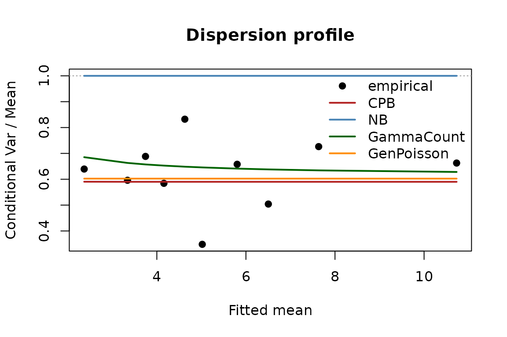
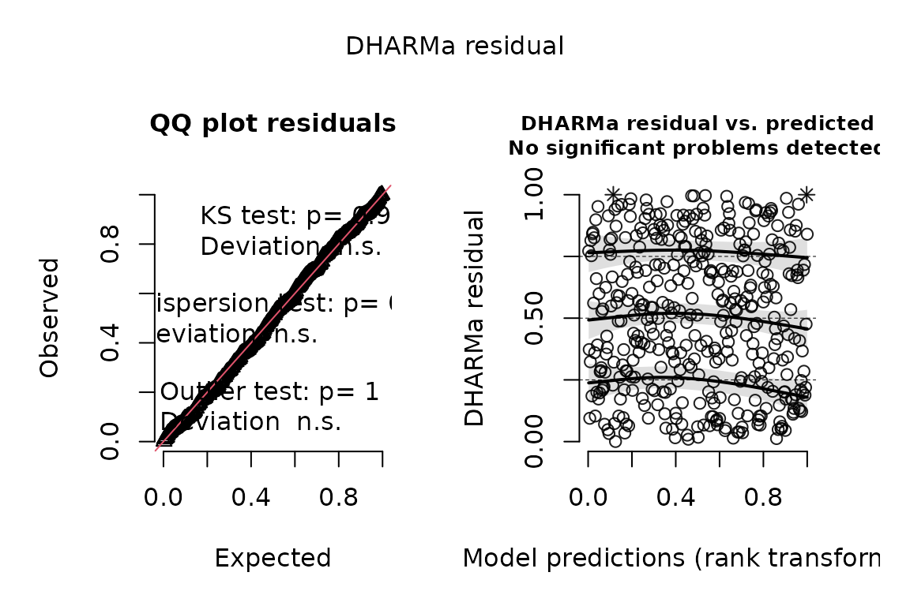

# Detecting and Modeling Underdispersed Counts

`underdisp` provides tools for detecting and modeling *underdispersion*
in count data: the case where the conditional variance is below the
conditional mean, so counts cluster more tightly around their
expectation than a Poisson allows. The Poisson and negative binomial
defaults cannot represent it; the negative binomial in particular
collapses onto the Poisson when the data are underdispersed.

``` r

library(underdisp)
```

## Simulating an underdispersed count

We generate a count with a conditional variance-to-mean ratio of about
one half.

``` r

n <- 400
x <- rnorm(n)
N <- pmax(round(exp(1.6 + 0.5 * x) / 0.5), 1)
y <- rbinom(n, N, 0.5)
d <- data.frame(y = y, x = x)
c(mean = mean(y), var = var(y), ratio = var(y) / mean(y))
#>      mean       var     ratio 
#>  5.527500 10.435332  1.887894
```

## Screening

[`ud_screen()`](https://bagozzib.github.io/underdisp/reference/ud_screen.md)
returns a marginal verdict, and, for zero-inflated outcomes, an at-risk
verdict benchmarked against a *zero-truncated* Poisson (which is what
separates genuine underdispersion from the artifact of conditioning on
positive counts).

``` r

ud_screen(y ~ x, data = d, run_cpb = FALSE)
#> 
#> === Underdispersion screen ===
#> Formula: y ~ x 
#> N=400  mean=5.527  max=22  %zero=1.8  (unconditional var/mean=1.89)
#> 
#> MARGINAL verdict: UNDERDISPERSED 
#>    Pearson=0.564  prop.slope=-0.391 (p=<2e-16)
#>    NB vs Poisson LR = 0, at the Poisson boundary (p= 0.5 asymptotic boundary mixture )
#> 
#> AT-RISK (y>0) verdict:UNDERDISPERSED  [n_pos=393]
#>    ZTP-Pearson = 0.569  (underdispersed if < 0.885, the calibrated 5% threshold)
#> 
#> Model comparison (log-lik):
#>  Poisson       NB       GP     COMP      CPB 
#> -798.901 -798.904 -770.154 -772.010       NA 
#>    CPB not fit: run_cpb = FALSE
#> 
#> COM-Poisson (full data): nu = 1.84  (> 1 = underdispersed, soft tail)
```

## Fitting the continuous parameter binomial

[`cpb()`](https://bagozzib.github.io/underdisp/reference/cpb.md) fits
the CPB. These counts are not zero-inflated, so the untruncated model is
fit to all of them. Its default, `truncated = TRUE`, is for the positive
counts of a zero-inflated outcome, the intensity of a hurdle model.

``` r

fit <- cpb(y ~ x, data = d, truncated = FALSE, se = "none")
summary(fit)
#> 
#> Continuous Parameter Binomial regression (untruncated)
#> N = 400    inference: none 
#> 
#>             Estimate Std. Error z value Pr(>|z|)
#> (Intercept)  1.57677         NA      NA       NA
#> x            0.49636         NA      NA       NA
#> 
#> alpha = 0.5527   (first-order profile 95% CI: 0.488 to 0.634)
#> Implied ceiling lambda/(1-alpha): median 10.68   range 2.58 to 40.3 
#> logLik = -769.78    AIC = 1545.55 
#> LR vs Poisson (H0: alpha = 1): 58.25, p 1.1554e-14
#> Note: the p-value is asymptotic, which over-rejects in finite samples at this boundary; dispersion_test() gives the parametric-bootstrap p-value.
```

The dispersion parameter `alpha` summarizes the compression, and each
observation carries an implied ceiling `lambda / (1 - alpha)`, the CPB’s
continuous number of trials; no count above its integer ceiling has
positive probability. This is King’s (1989) CPB, which is the
generalized event count of
[`gec()`](https://bagozzib.github.io/underdisp/reference/gec.md) at
`delta = alpha` (`support = "floor"` gives the package’s definition
before version 0.2.0). The CPB is a binomial with a non-integer number
of trials, renormalized over its finite support, so its mean is not
exactly the rate `exp(x'b)`:
[`fitted()`](https://rdrr.io/r/stats/fitted.values.html) and
`predict(type = "response")` report the exact mean of the fitted
distribution (the conditional mean given `Y >= 1` for a zero-truncated
fit), and `predict(type = "rate")` the rate.

## Quantities of interest

Predicted means, the implied ceiling, and first differences are
available for user-specified covariate profiles, and
[`ame()`](https://bagozzib.github.io/underdisp/reference/ame.md)
averages a marginal effect over the rows of a data set.

``` r

predict(fit, newdata = data.frame(x = c(-1, 0, 1)), type = "response")
#> [1] 2.946126 4.839306 7.949678
implied_ceiling(fit, newdata = data.frame(x = 0))
#>     lambda  ceiling max_count ceiling_at_alpha_lower ceiling_at_alpha_upper
#> 1 4.839299 10.81911        11               9.446006               13.22572
first_difference(fit, "x", from = -1, to = 1)
#>  component  from   to  diff
#>       mean 2.946 7.95 5.004
```

## Testing equidispersion

The Poisson is the equidispersed member of every family in the package
(`alpha = 1` for the CPB, `delta = 1` for the GEC, `nu = 1` for the
COM-Poisson, and so on), so
[`dispersion_test()`](https://bagozzib.github.io/underdisp/reference/dispersion_test.md)
tests a fitted model’s dispersion parameter against its Poisson value by
a likelihood-ratio test on the fitted design, with fixed effects carried
into the null. Where the Poisson value sits on the boundary of the
parameter space (the CPB, the negative binomial) the test is one-sided,
and its p-value comes by default from a parametric bootstrap under the
fitted Poisson, because the asymptotic Self–Liang mixture over-rejects
in finite samples; `B = 0` gives the quick asymptotic value shown here.
Elsewhere the alternative can be two-sided or directional. For a plain
Poisson fit the Cameron–Trivedi auxiliary regression is available as
`method = "auxiliary"`.

``` r

dispersion_test(fit, B = 0)   # asymptotic value; the default is the bootstrap p-value
#> 
#> Likelihood-ratio test of equidispersion (CPB vs Poisson; boundary null; asymptotic 1/2 chi2_0 + 1/2 chi2_1 mixture)
#> 
#> data: y ~ x
#> LR = 58.2479  (logLik: fitted family = -769.78, Poisson = -798.90),  p-value = 1.155e-14
#> alternative hypothesis: underdispersion
#> note: the p-value is asymptotic; at a boundary null the statistic is skewed toward rejection in finite samples, and the default (B = NULL) calibrates it by parametric bootstrap
#> estimate: alpha = 0.5527  (Poisson value 1)
dispersion_test(count_reg(y ~ x, data = d, family = "poisson"),
                method = "auxiliary", alternative = "under")
#> 
#> Cameron-Trivedi auxiliary regression test of equidispersion (Var = mu + a mu^2)
#> 
#> data: y ~ x
#> t = -9.3813,  p-value = < 2.2e-16
#> alternative hypothesis: underdispersion
#> estimate: a = -0.0619  (Poisson value 0)
```

## Bootstrap inference

Hessian-based standard errors are unreliable for the CPB: an observation
whose ceiling lies just above an integer carries information about its
rate that grows without bound as the ceiling approaches the integer (see
[`?cpb`](https://bagozzib.github.io/underdisp/reference/cpb.md)).
Coefficient inference uses a cold-multistart pairs bootstrap. In
simulations from King’s CPB at n = 300, its 95% interval for a slope
covers 0.91 at `alpha` = 0.3, 0.95 at 0.5 and 0.94 at 0.7 (0.95 on the
floor support). At `alpha` = 0.3, neither a parametric bootstrap (0.918)
nor 999 replicates (0.924) brings it to the nominal level. The
dispersion parameter carries a profile-likelihood interval. That
interval is first-order by default. On King’s support it covers close to
its level in simulations (0.940 to 0.956). On the floor support it does
not: the estimate of `alpha` is biased toward zero there (the
log-ceiling coefficients behave like endpoint parameters), so it covers
about 0.90 to 0.94, with most misses on the upper side.
[`calibrate_alpha()`](https://bagozzib.github.io/underdisp/reference/calibrate_alpha.md)
is the opt-in remedy for floor-support fits and an optional refinement
on King’s. It stores the parametric-bootstrap distribution of the signed
root of the profile likelihood ratio in the fit
(`fit <- calibrate_alpha(fit, B = 199, cores = 4, seed = 1)`, about a
third of a fit per replicate), after which
[`alpha_confint()`](https://bagozzib.github.io/underdisp/reference/alpha_confint.md),
[`confint()`](https://rdrr.io/r/stats/confint.html),
[`implied_ceiling()`](https://bagozzib.github.io/underdisp/reference/implied_ceiling.md)
and [`summary()`](https://rdrr.io/r/base/summary.html) report the
calibrated interval. Both intervals are model-based and assume
independent observations. `cores =` runs the replicates on a socket
cluster seeded from the session.

The bootstrap draws also carry the quantities of interest.
[`first_difference()`](https://bagozzib.github.io/underdisp/reference/first_difference.md),
`predict(interval = "confidence")` and
[`ame()`](https://bagozzib.github.io/underdisp/reference/ame.md) compute
the quantity at every draw, the dispersion parameter included, and
report its percentile interval; a fit without draws uses the delta
method where its family has a covariance.

``` r

fit_b <- cpb(y ~ x, data = d, truncated = FALSE, se = "bootstrap", B = 200)
summary(fit_b)
#> 
#> Continuous Parameter Binomial regression (untruncated)
#> N = 400    inference: bootstrap 
#> 
#>             Estimate Std. Error z value  Pr(>|z|)    
#> (Intercept) 1.576770   0.017862  88.274 < 2.2e-16 ***
#> x           0.496362   0.018418  26.950 < 2.2e-16 ***
#> ---
#> Signif. codes:  0 '***' 0.001 '**' 0.01 '*' 0.05 '.' 0.1 ' ' 1
#> 
#> alpha = 0.5527   (first-order profile 95% CI: 0.488 to 0.634)
#> Implied ceiling lambda/(1-alpha): median 10.68   range 2.58 to 40.3 
#> logLik = -769.78    AIC = 1545.55 
#> LR vs Poisson (H0: alpha = 1): 58.25, p 1.1554e-14
#> Note: the p-value is asymptotic, which over-rejects in finite samples at this boundary; dispersion_test() gives the parametric-bootstrap p-value.
#> (200 bootstrap resamples converged)
irr(fit_b)             # rate ratios with percentile intervals
#>         term equation ratio estimate lower upper             method
#>  (Intercept)    count   IRR    4.839 4.679 5.009 bootstrap (stored)
#>            x    count   IRR    1.643 1.580 1.694 bootstrap (stored)
confint(fit_b)         # coefficients (percentile) and alpha (first-order profile likelihood)
#>                 2.5 %    97.5 %
#> (Intercept) 1.5431636 1.6111519
#> x           0.4572332 0.5273667
#> alpha       0.4876884 0.6340994
first_difference(fit_b, "x", from = -1, to = 1)
#>  component  from   to  diff lower upper             method
#>       mean 2.946 7.95 5.004 4.619 5.335 bootstrap (stored)
predict(fit_b, newdata = data.frame(x = c(-1, 1)), interval = "confidence")
#>           fit      lwr      upr
#> [1,] 2.946126 2.789861 3.132517
#> [2,] 7.949678 7.618562 8.258089
#> attr(,"method")
#> [1] "bootstrap (stored)" "bootstrap (stored)"
ame(fit_b, "x", newdata = d)   # the average marginal effect over the sample
#>  term contrast     type estimate lower upper             method   n
#>     x    dY/dx response    2.743 2.504 2.949 bootstrap (stored) 400
```

## Mean effects and the robust Poisson

For the conditional mean alone, the Poisson with robust standard errors
is the benchmark: its coefficients are consistent whenever the mean is
`exp(x'b)`, whatever the distribution (Gourieroux, Monfort and Trognon
1984; Wooldridge 1999), and its robust intervals hold under
underdispersion as under overdispersion. The CPB’s mean effects are
consistent only when the CPB is the data’s process. On underdispersed
counts from another process (binomial counts with varying trials, a
COM-Poisson) its average marginal effects can be off by several percent
at any sample size, while the robust Poisson’s stay on target; when the
CPB is the process, its effects are consistent, and the Poisson’s are a
little off, since the CPB’s mean is not exactly log-linear. What the CPB
adds is the distribution: predicted probabilities, the ceiling, the
share of zeros, intervals for a count. The two average marginal effects
side by side are a check worth reporting.

``` r

pml <- count_reg(y ~ x, data = d, family = "poisson", se = "robust")
ame(pml, "x", newdata = d)     # robust Poisson
#>  term contrast     type estimate lower upper method   n
#>     x    dY/dx response    2.739 2.516 2.962  delta 400
ame(fit_b, "x", newdata = d)   # CPB
#>  term contrast     type estimate lower upper             method   n
#>     x    dY/dx response    2.743 2.504 2.949 bootstrap (stored) 400
```

## The free-dispersion GEC

[`gec()`](https://bagozzib.github.io/underdisp/reference/gec.md) fits
King’s generalized event count (Katz) model, whose dispersion `delta` is
estimated freely, so the data choose the direction of dispersion rather
than the analyst presuming it. On the underdispersed count above it
recovers `delta` well below one; on a Poisson outcome it sits at one.

``` r

gec(y ~ x, data = d, se = "none")                                  # delta ~ 0.5
#> Generalized event count (Katz family) regression
#> Call:  gec(formula = y ~ x, data = d, se = "none")
#> (Intercept)           x 
#>      1.5768      0.4964 
#> 
#> dispersion delta (Katz; Var/Mean on an unbounded support) = 0.553  [underdispersed (LR p = 2.3e-14)]
#> logLik = -769.78,  n = 400
gec(y ~ x, data = data.frame(y = rpois(n, exp(1 + 0.4 * x)), x = x),
    se = "none")                                                   # delta ~ 1
#> Generalized event count (Katz family) regression
#> Call:  gec(formula = y ~ x, data = data.frame(y = rpois(n, exp(1 + 0.4 *     x)), x = x), se = "none")
#> (Intercept)           x 
#>      1.0510      0.3873 
#> 
#> dispersion delta (Katz; Var/Mean on an unbounded support) = 0.879  [equidispersion not rejected (LR p = 0.08)]
#> logLik = -746.22,  n = 400
```

The GEC carries the same zero-truncated, hurdle
([`hurdle_gec()`](https://bagozzib.github.io/underdisp/reference/hurdle_gec.md)),
zero-inflated
([`zi_gec()`](https://bagozzib.github.io/underdisp/reference/zi_gec.md)),
and fixed-effects
([`gec_fe()`](https://bagozzib.github.io/underdisp/reference/gec_fe.md))
variants as the CPB.

## High-dimensional fixed effects

Underdispersion is typically a *within-unit* phenomenon that pooled
analyses hide.
[`cpb_fe()`](https://bagozzib.github.io/underdisp/reference/cpb_fe.md)
absorbs a full set of unit fixed effects by concentrating them out of
the likelihood, so it scales to thousands of units.

``` r

panel <- do.call(rbind, lapply(1:30, function(i) {
  xx <- rnorm(12); NN <- pmax(round(exp(rnorm(1, 0, 0.4) + 0.4 * xx) / 0.5), 1)
  data.frame(unit = i, x = xx, y = rbinom(12, NN, 0.5))
}))
fe_fit <- cpb_fe(y ~ x, data = panel, fe = "unit")
fe_fit
#> CPB regression with 30 unit fixed effects (concentrated likelihood)
#> Coefficients:
#>      x 
#> 0.4002 
#> 
#> alpha (shape parameter): 0.3746   median largest feasible count: 2 
#> Note: alpha is subject to incidental-parameters bias for short panels; see ?cpb_fe.
dispersion_test(fe_fit, B = 0)   # the statistic against a Poisson with the same unit effects
#> 
#> Likelihood-ratio test of equidispersion (CPB vs Poisson; boundary null; asymptotic 1/2 chi2_0 + 1/2 chi2_1 mixture)
#> 
#> data: y ~ x
#> LR = 114.8203  (logLik: fitted family = -364.90, Poisson = -422.31),  p-value = NA
#> alternative hypothesis: underdispersion
#> note: unit fixed effects bias the dispersion estimate toward underdispersion, so the asymptotic distribution does not apply; B > 0 gives the parametric-bootstrap p-value
#> estimate: alpha = 0.3746  (Poisson value 1)
```

With unit fixed effects the asymptotic distribution of that statistic
does not apply, so its p-value comes from a parametric bootstrap under
the fitted Poisson. Every replicate refits the model, which makes the
bootstrap about 199 times as slow as the fit; it is not run here:

``` r

dispersion_test(fe_fit, cores = 2)   # parametric-bootstrap p-value, 199 replicates
```

## Comparing the family

[`compare_dispersion()`](https://bagozzib.github.io/underdisp/reference/compare_dispersion.md)
fits the Poisson, negative binomial, the native soft-tail COM-Poisson,
the free-dispersion GEC, and the hard-ceiling CPB, and reports a fit
comparison. The CPB’s bound itself is tested on held-out counts: in
sample every feasible fit respects it, since its likelihood forbids
exceedance.
[`ceiling_exceedance()`](https://bagozzib.github.io/underdisp/reference/ceiling_exceedance.md)
counts the held-out observations above it.

``` r

compare_dispersion(y ~ x, data = d)$table
#>             df    logLik      AIC      BIC logscore       rps    zero_fit
#> Poisson      2 -798.9009 1601.802 1609.785 1.997252 0.9855061 0.024243957
#> NegBinomial  3 -798.9042 1603.808 1615.783 1.997261 0.9855095 0.024244780
#> COM-Poisson  3 -772.0096 1550.019 1561.994 1.930024 0.9631112 0.009312565
#> CPB          3 -769.7769 1545.554 1557.528 1.924442 0.9644026 0.010538425
#> GEC          3 -769.7769 1545.554 1557.528 1.924442 0.9644021 0.010539387
#>             converged
#> Poisson          TRUE
#> NegBinomial      TRUE
#> COM-Poisson      TRUE
#> CPB              TRUE
#> GEC              TRUE
ceiling_exceedance(cpb(y ~ x, data = d[1:300, ], truncated = FALSE, se = "none"), d[301:400, ])
#>     n exceed share
#> 1 100      0     0
```

## The wider underdispersed family

Underdispersion has more than one mechanism, and
[`count_reg()`](https://bagozzib.github.io/underdisp/reference/count_reg.md)
fits the distributions that express them through one interface: the
classical COM-Poisson (`"compois"`, rate-parameterized) and Huang’s
mean-parameterized COM-Poisson (`"mpcmp"`, a soft tail), the Consul–Jain
generalized Poisson (`"genpois"`, constant variance-to-mean ratio,
finite support when underdispersed), Winkelmann’s gamma-count
(`"gammacount"`, events with more regular timing than a Poisson
process), Efron’s double Poisson (`"doublepois"`), the hyper-Poisson of
Bardwell and Crow in the mean parameterization of Sáez-Castillo and
Conde-Sánchez (`"hyperpois"`, with constant dispersion), and Ridout and
Besbeas’s exponentially weighted Poisson (`"ewp3"`, one weight per tail,
and its one-weight form `"ewp2"`). Each inherits fixed effects,
zero-truncation, hurdle and zero-inflated forms, offsets, frequency
weights, robust and cluster-robust standard errors, and every method in
the package, so
[`compare_models()`](https://bagozzib.github.io/underdisp/reference/compare_models.md)
places them next to the CPB on one footing.

``` r

dw <- d[1:150, ]                         # part of the sample keeps the seven fits quick
fits <- list(
  CPB          = cpb(y ~ x, data = dw, truncated = FALSE, se = "none"),
  Poisson      = count_reg(y ~ x, data = dw, family = "poisson"),
  NB           = count_reg(y ~ x, data = dw, family = "negbin"),
  `COM-Poisson`= count_reg(y ~ x, data = dw, family = "mpcmp"),
  GenPoisson   = count_reg(y ~ x, data = dw, family = "genpois"),
  GammaCount   = count_reg(y ~ x, data = dw, family = "gammacount"),
  DoublePois   = count_reg(y ~ x, data = dw, family = "doublepois")
)
do.call(compare_models, fits)
#>             df    logLik      AIC      BIC logscore      rps truncated
#> CPB          3 -297.1659 600.3318 609.3637 1.981106 1.018841     FALSE
#> GenPoisson   3 -297.4525 600.9050 609.9369 1.983017 1.018599     FALSE
#> GammaCount   3 -299.0185 604.0369 613.0688 1.993456 1.018395     FALSE
#> COM-Poisson  3 -299.2068 604.4135 613.4454 1.994712 1.019137     FALSE
#> DoublePois   3 -299.9026 605.8053 614.8372 1.999351 1.019015     FALSE
#> Poisson      2 -305.3268 614.6535 620.6748 2.035512 1.029690     FALSE
#> NB           3 -305.3268 616.6535 625.6854 2.035512 1.029691     FALSE
#>             separated
#> CPB             FALSE
#> GenPoisson      FALSE
#> GammaCount      FALSE
#> COM-Poisson     FALSE
#> DoublePois      FALSE
#> Poisson         FALSE
#> NB              FALSE
```

On underdispersed data the negative binomial collapses onto the Poisson,
while the underdispersed families capture the compression and win on AIC
and the proper scores. The families differ in how their dispersion moves
with the mean, and
[`dispersion_profile()`](https://bagozzib.github.io/underdisp/reference/dispersion_profile.md)
sets the empirical conditional variance-to-mean ratio, by bins of the
fitted mean, against the curve each family implies:

``` r

dispersion_profile(CPB = fits$CPB, NB = fits$NB, GammaCount = fits$GammaCount,
                   GenPoisson = fits$GenPoisson)
```



The correlated-random-effects device
([`mundlak()`](https://bagozzib.github.io/underdisp/reference/mundlak.md))
and matching `d`/`p`/`q`/`r` functions
([`dcpb()`](https://bagozzib.github.io/underdisp/reference/cpb-distribution.md),
[`dgec()`](https://bagozzib.github.io/underdisp/reference/gec-distribution.md),
[`dcompois()`](https://bagozzib.github.io/underdisp/reference/compois-distribution.md),
[`dgammacount()`](https://bagozzib.github.io/underdisp/reference/gammacount-distribution.md),
[`dgenpois()`](https://bagozzib.github.io/underdisp/reference/genpois-distribution.md),
[`ddoublepois()`](https://bagozzib.github.io/underdisp/reference/doublepois-distribution.md),
[`dhyperpois()`](https://bagozzib.github.io/underdisp/reference/hyperpois-distribution.md),
[`dewp()`](https://bagozzib.github.io/underdisp/reference/ewp-distribution.md))
round out the family.

## Excess zeros: hurdle and zero-inflated models

Many count outcomes mix a participation process (most units at zero)
with a tight positive count. The bundled peacekeeping panel – the number
of UN operations each state contributes troops to per year – shows the
package’s central move: marginally the count looks overdispersed, but
conditioning on country fixed effects and benchmarking the positive
counts against a zero-truncated Poisson, the at-risk process is
underdispersed.

``` r

data(peacekeeping)
ud_screen(contributions ~ democracy + lgdppc + lpop + milper + factor(iso3),
          data = peacekeeping, run_cpb = FALSE, run_gp = FALSE)
#> 
#> === Underdispersion screen ===
#> Formula: contributions ~ democracy + lgdppc + lpop + milper + factor(iso3) 
#> N=4448  mean=3.191  max=18  %zero=41.5  (unconditional var/mean=4.56)
#> 
#> MARGINAL verdict: OVERDISPERSED 
#>    Pearson=1.086  prop.slope=0.191 (p=<2e-16)
#>    NB vs Poisson LR = 18.11 (p= 1e-05 asymptotic boundary mixture ; sig => overdispersion)
#> 
#> AT-RISK (y>0) verdict:UNDERDISPERSED  [n_pos=2602]
#>    ZTP-Pearson = 0.841  (underdispersed if < 0.955, the calibrated 5% threshold)
#> 
#> Model comparison (log-lik):
#>   Poisson        NB        GP      COMP       CPB 
#> -6645.816 -6636.761        NA        NA        NA 
#>    CPB not fit: run_cpb = FALSE
#>    GP not fit: run_gp = FALSE
#>    COMP not fit: more than comp_max_par = 30 parameters
```

That is the case for a two-part model with an underdispersed intensity.
[`hurdle_cpb()`](https://bagozzib.github.io/underdisp/reference/hurdle_cpb.md)
joins a participation logit to a zero-truncated CPB, and
[`zi_cpb()`](https://bagozzib.github.io/underdisp/reference/zi_cpb.md)
fits the structural-zero mixture. The two are not nested, so
[`compare_models()`](https://bagozzib.github.io/underdisp/reference/compare_models.md)
adjudicates between them, on information criteria and proper scores
([`cv_score()`](https://bagozzib.github.io/underdisp/reference/cv_score.md)
holds them out);
[`zi_test()`](https://bagozzib.github.io/underdisp/reference/zi_test.md)
tests a mixture with intercept-only inflation against its non-inflated
nest.

``` r

z <- rnorm(n)
yh <- rhurdle_cpb(n, lambda = exp(1.2 + 0.3 * x), alpha = 0.5,
                  p = plogis(0.3 + 0.8 * z))
dh <- data.frame(y = yh, x = x, z = z)
h <- hurdle_cpb(y ~ x, data = dh, participation = ~ z)
zi <- zi_cpb(y ~ x, data = dh, zero = ~ z)
compare_models(hurdle = h, mixture = zi)
#>         df    logLik      AIC      BIC logscore      rps truncated separated
#> hurdle   5 -626.8919 1263.784 1283.741 1.567230 1.044975     FALSE     FALSE
#> mixture  5 -627.5024 1265.005 1284.962 1.568756 1.046229     FALSE     FALSE
```

The hurdle’s
[`first_difference()`](https://bagozzib.github.io/underdisp/reference/first_difference.md)
reports the change on each margin, the participation probability and the
conditional mean, beside the marginal mean – which channel a covariate
moves, not just the blended marginal effect. One practical note: because
the hurdle factorizes, its participation stage is an ordinary logistic
regression; the hurdles check it for separation and warn, and if a
dummy-heavy participation equation separates, fit that stage with a
dedicated bias-reduction package (`logistf`, `brglm2`) alongside this
package’s zero-truncated intensity. The mixture’s zero equation can
separate even where the hurdle’s logit does not, since the count
component’s probability of a zero covers the zeros on the wrong side.
[`zi_cpb()`](https://bagozzib.github.io/underdisp/reference/zi_cpb.md),
[`zi_gec()`](https://bagozzib.github.io/underdisp/reference/zi_gec.md)
and
[`zi_count()`](https://bagozzib.github.io/underdisp/reference/zi_count.md)
check for this after the fit and warn (see the Separation section of
[`?zi_cpb`](https://bagozzib.github.io/underdisp/reference/zi_cpb.md)).

## Weights

Every estimator takes frequency `weights` (a weight of `w` is equivalent
to `w` copies of the row, in the likelihood, the information, and the
bootstrap), so tabulated data fit exactly as the expanded data would:

``` r

w <- sample(1:3, n, TRUE)
c(weighted = count_reg(y ~ x, data = d, family = "gammacount", weights = w)$loglik,
  expanded = count_reg(y ~ x, data = d[rep(seq_len(n), w), ], family = "gammacount")$loglik)
#>  weighted  expanded 
#> -1525.155 -1525.155
```

## Short panels: bias-corrected fixed effects

The concentrated fixed-effects dispersion estimate carries the
incidental- parameters bias of order 1/T: with few observations per
unit, `alpha` is biased *downward* (the panel looks more underdispersed
than it is). `bias_correct = "jackknife"` removes the leading bias term
by the split-panel jackknife of Dhaene and Jochmans (2015), refitting on
each unit’s temporal halves; `time` names the column that orders each
unit’s rows.

``` r

short <- do.call(rbind, lapply(1:16, function(i) {
  xx <- rnorm(8); NN <- pmax(round(exp(1.0 + rnorm(1, 0, 0.4) + 0.3 * xx) / 0.5), 1)
  data.frame(unit = i, t = 1:8, x = xx, y = rbinom(8, NN, 0.5))
}))
ml <- cpb_fe(y ~ x, data = short, fe = "unit")
jk <- cpb_fe(y ~ x, data = short, fe = "unit", bias_correct = "jackknife", time = "t")
c(ml = ml$alpha, jackknife = jk$alpha)   # truth is 0.5; ML is biased downward
#>        ml jackknife 
#> 0.3336481 0.3719612
```

The correction is only valid when the two half-panels estimate the same
parameter (the method’s time-homogeneity requirement), so it carries a
validity gate: the panel is also split cross-sectionally by units – a
placebo that is exchangeable under any time pattern – and if the
temporal halves disagree beyond that placebo noise, the correction is
*refused* with a warning naming the failed assumption and the
maximum-likelihood fit is returned. On a trending or regime-changing
panel, the refusal is the correct answer. The gate is deliberately
powered over sized: in calibration it refuses 9% to 13% of genuinely
homogeneous panels (you keep the ordinary ML fit) while catching 98.5%
of dispersion regime changes and all smooth unmodeled trends.

## Simulated-residual diagnostics with DHARMa

Every fitted model in the package has a
[`simulate()`](https://rdrr.io/r/stats/simulate.html) method, so the
whole family plugs into `DHARMa`’s simulated-residual diagnostics.

``` r

sims <- simulate(h, nsim = 100, seed = 1)
res <- DHARMa::createDHARMa(simulatedResponse = as.matrix(sims),
                            observedResponse  = dh$y,
                            fittedPredictedResponse = fitted(h),
                            integerResponse = TRUE)
plot(res)
#> Warning in newton(lsp = lsp, X = G$X, y = G$y, Eb = G$Eb, UrS = G$UrS, L = G$L,
#> : Fitting terminated with step failure - check results carefully
```


